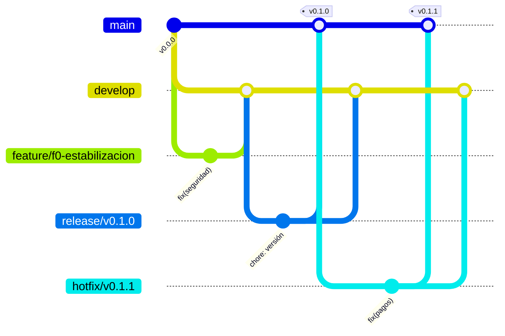

# Git Flow

## Ramas



| Rama | Sale de | Entra en | Uso | Entorno |
|---|---|---|---|---|
| `main` | — | — | Código en producción. Solo recibe `release/*` y `hotfix/*`. Cada merge lleva una etiqueta `vX.Y.Z`. | Producción (Vercel + Neon `main`) |
| `develop` | `main` | — | Integración de la siguiente versión. Siempre debe pasar CI. | Vista previa estable (Vercel + Neon `develop`) |
| `feature/<fase>-<tema>` | `develop` | `develop` | Una funcionalidad o tarea. Vida corta: idealmente menos de una semana. | Vista previa por PR |
| `release/vX.Y.0` | `develop` | `main` y `develop` | Congelar una versión: solo correcciones, versión y notas. | Vista previa |
| `hotfix/vX.Y.Z` | `main` | `main` y `develop` | Corrección urgente en producción. | Vista previa |

### Nombres de rama

- Prefijo de fase: `f0`…`f6` según [ESTADO.md](ESTADO.md). Ejemplos: `feature/f1-esquema-geo`, `feature/f3-adaptador-yappy`.
- Trabajo transversal sin fase: `feature/docs-…`, `feature/ci-…`.
- Minúsculas, palabras separadas por guiones y sin tildes.

## Commits

[Conventional Commits](https://www.conventionalcommits.org/es/) en español:

```
<tipo>(<módulo>): <qué cambia, en imperativo>

<por qué, si no es obvio>
```

- **Tipos**: `feat`, `fix`, `docs`, `refactor`, `test`, `chore`, `ci`, `perf`, `build`.
- **Módulos**: `identidad`, `geo`, `catalogo`, `tarifas`, `reservas`, `pagos`, `soporte`, `experiencias`, `auditoria`, `web`, `admin`, `extranet`, `infra`, `seguridad`, `legacy` (código Express actual).
- Un cambio que rompe compatibilidad lleva `!` (`feat(pagos)!: …`) y una sección `BREAKING CHANGE:` en el cuerpo.

## Pull requests

1. Abre el PR contra `develop` (o contra `main` si es `release/*` o `hotfix/*`).
2. Completa la plantilla: qué cambia, cómo probarlo y qué ítems de [ESTADO.md](ESTADO.md) avanza.
3. **CI en verde** es obligatorio: pruebas (y lint cuando exista).
4. Al menos **una aprobación**. Si el cambio toca pagos, márgenes o datos personales, se requieren dos.
5. Forma de integrar:
   - `feature/*` → `develop`: **squash merge**, con el título del PR en formato de commit convencional.
   - `release/*` y `hotfix/*` → `main`: **merge commit** (`--no-ff`), y luego merge de vuelta a `develop`.
6. Si la base de datos cambia, el PR incluye la migración y su prueba. Nunca se edita una migración ya publicada.

## Versiones

[SemVer](https://semver.org/lang/es/). Mientras no hay lanzamiento público, cada fase cierra una versión menor:

| Versión | Contenido |
|---|---|
| `v0.1.0` | Fase 0: estabilización |
| `v0.2.0` | Fase 1: esquema nuevo, identidad, cálculo de precio |
| `v0.3.0` | Fase 2: web pública es/en y centro de ayuda |
| `v1.0.0` | Fase 3: cobro del anticipo y **lanzamiento en Panamá** |
| `v1.1.0` | Fase 4: asistente con IA |
| `v1.2.0` | Fase 5: extranet de hoteles |

## Protección de ramas (configurar en GitHub)

En `main` y `develop`: requerir PR, CI en verde y una aprobación; prohibir push directo y force-push. En `main`, además, exigir que la rama esté actualizada antes de integrar.

## Variables y secretos

- Nunca se suben `.env` ni credenciales. `.env.example` lista todas las variables sin valores.
- Secretos de producción y de vista previa: en Vercel → Project Settings → Environment Variables, separados por entorno.
- Las credenciales de las pasarelas de **pruebas** van solo en vista previa y las **reales** solo en producción.
