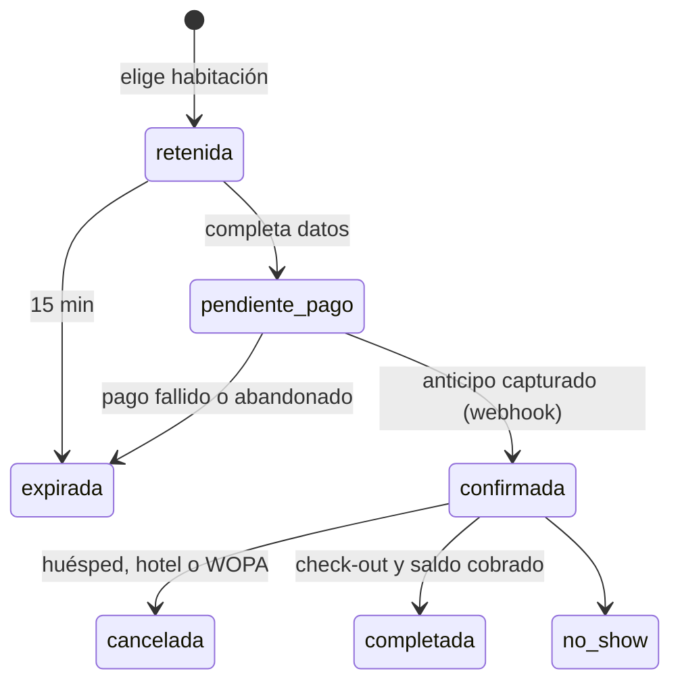

# 02 · Arquitectura de software

## Estilo

**Monolito modular** en TypeScript ([ADR-002](../decisiones.md)). Un despliegue en Vercel. Cada módulo:

- es dueño de un esquema de Postgres con su mismo nombre;
- expone un servicio (`<modulo>/servicio.ts`). Los demás módulos no leen sus tablas directamente;
- valida sus entradas con Zod.

| Módulo | Responsabilidad |
|---|---|
| `identidad` | Usuarios, organizaciones, membresías, invitaciones y roles (`wopa_admin`, `wopa_operaciones`, `wopa_soporte`, `wopa_finanzas`, `hotel_admin`, `hotel_recepcion`) |
| `geo` | Países, ciudades, zonas, idiomas, monedas y tipos de cambio |
| `catalogo` | Hoteles, habitaciones, servicios, fotos, traducciones y revisión de contenido |
| `tarifas` | Planes, tarifa neta por día, reglas de margen, anticipo, cupos, políticas e impuestos |
| `reservas` | Máquina de estados, retención de cupo y precio congelado por noche |
| `pagos` | Proveedores, enrutamiento, webhooks, devoluciones, asientos y liquidaciones |
| `soporte` | Conversaciones con el asistente, tickets y centro de ayuda |
| `experiencias` | Tours y cotizaciones (lo que existe hoy) |
| `auditoria` | Bitácora de cambios y alertas |

## Estructura del repositorio

Estado de **transición**: el código actual sigue en la raíz mientras se construye el nuevo.

```
wopa-hotel-web-main/
├─ api/[...path].js          # (legado) entrada de Vercel para Express
├─ server/                   # (legado) API Express actual
├─ public/                   # (legado) web y panel actuales
├─ test/                     # (legado) pruebas de integración actuales
├─ docs/                     # esta documentación
├─ apps/                     # (fase 1+) aplicaciones nuevas
│  └─ web/                   # Next.js: web pública, extranet, panel y API v1
├─ packages/                 # (fase 1+) código compartido
│  ├─ db/                    # esquema Drizzle, migraciones SQL, seeds
│  ├─ dominio/               # módulos: identidad, geo, catalogo, tarifas, …
│  ├─ pagos/                 # interfaz ProveedorPago + adaptadores
│  └─ ui/                    # sistema de diseño
└─ .github/                  # CI y plantillas
```

Cuando la fase 2 reemplace la web actual, `server/`, `public/` y `api/` se borran en un PR propio.

## Rutas de la web nueva

```
app/[locale]/                 es | en
  destinos/[pais]/[ciudad]/   estática con ISR
  buscar/                     dinámica (?destino&entrada&salida&huespedes)
  hotel/[slug]/               contenido estático + precios en vivo
  reservar/[codigo]/          datos del huésped → pago del anticipo
  reservar/[codigo]/resultado/
  mi-reserva/[codigo]/
  ayuda/ · ayuda/[slug]/
  extranet/                   ficha, habitaciones, calendario, reservas, liquidaciones, soporte
app/admin/                    hoteles, margenes, revision, salud, reservas, pagos, soporte, finanzas
app/api/v1/                   REST
```

## Convenciones de la API

- REST versionada en `/api/v1`, documentada con OpenAPI.
- Errores con forma fija: `{ "error": { "code": "DATES_INVALID", "field": "fechaSalida" } }`. El frontend traduce el código.
- Cabecera `Idempotency-Key` al crear reservas y pagos.
- Dinero como entero en centavos junto con su moneda ISO 4217.
- Las fechas de estadía en formato `YYYY-MM-DD`, y los instantes en ISO 8601 UTC.

## Ciclo de vida de una reserva



La retención descuenta cupo con un `UPDATE … WHERE cupo_total - cupo_vendido >= n` dentro de la transacción. Si se actualizan menos filas que noches, se hace `ROLLBACK`.
